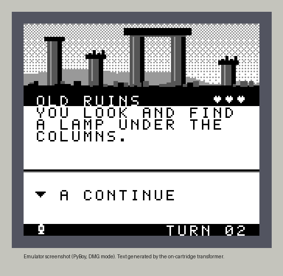
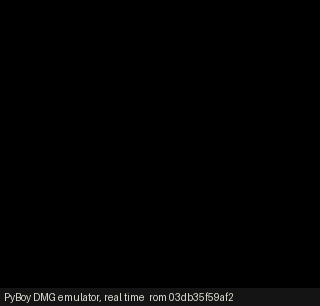
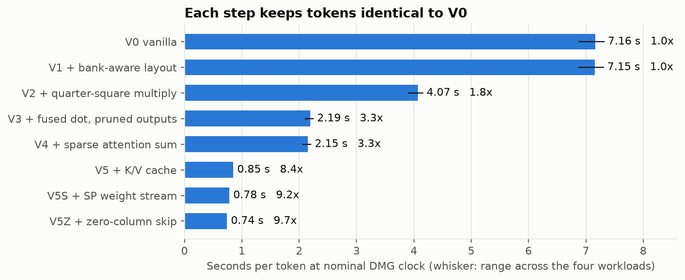

# GameBoyGPT: 8-Bit Adventure

A choose-your-own-adventure game for the original 1989 Game Boy, where a tiny transformer running on the console's 8-bit CPU writes each story event, one word at a time. There is no server, GPU or lookup table of sentences: the attention, matrix math and sampling are all SM83 assembly.



*Emulator screenshot (PyBoy, DMG mode). This has not been run on a physical Game Boy.*



The project then asks a measurement question: **what actually makes neural text generation faster on a 4 MHz, 8-bit CPU with 8 KB of RAM?** Every optimization below was built separately, checked for identical output and timed in T-cycles.

## Results

<!-- generated by tools/compare.py -->
| | V0 vanilla | V5Z shipping |
|---|---:|---:|
| Seconds per token (DMG clock) | 5.80 | 0.63 |
| Seconds per event | 56.6 | 6.2 |
| T-cycles per token | 24.3M | 2.7M |
| WRAM allocated | 2639 B | 2673 B |
| Tokens identical to V0 | n/a | yes |

**9.2x faster, same tokens.**
<!-- end generated -->

Same model, same weights, same prompts. V0 is a plain baseline that recomputes K and V for every token, which is why the second figure matters. Both builds pass the same tests against an independent integer reference, and SameBoy and PyBoy report identical frame counts for each. Full tables are in [RESULTS.md](RESULTS.md).



**What mattered, in order:**

1. **Stop recomputing keys and values.** With one layer, K and V for a position never change, so the K/V cache is a 2.43x step at the point it was added and costs no extra RAM, since the buffer already existed.
2. **Stop calling a multiply.** Inlining the MAC, holding `x` in HRAM and pruning output rows that decoding can never pick gave 1.81x. Quarter-square multiplication gave 1.76x before that.
3. **Skip real zeros, read weights cheaply.** 62% of feed-forward activations are exactly zero after ReLU. Skipping those columns gave 1.07x, and reading weights through `pop` gave 1.09x.

**What didn't matter:** the bank-aware ROM layout removed all 780 bank switches per token and saved 0.13%. A switch just isn't expensive next to the math.

## Play it

ROMs are in [`release/`](release/): `gameboygpt.gb` is the fast build and `gameboygpt_v0.gb` is the slow baseline. Open either in any Game Boy emulator set to DMG, or run `make play`.

| Button | Action |
|---|---|
| D-pad, A | Choose an action, continue |
| START | Run stats, measured on the device |
| SELECT on stats | New run |

Find a lamp, take the key from the cave, open the gate and climb the tower. See [docs/GAMEPLAY.md](docs/GAMEPLAY.md).

## How it works

```
Button press -> deterministic game rules -> outcome
                                              |
              <BOS> ROOM INVENTORY ACTION OUTCOME          symbolic prompt, 5 tokens
                                              |
                 1-layer transformer on the SM83           14,784 int8 weights in ROM
                 attention over all earlier tokens         K/V cache in WRAM
                                              |
                 next word, drawn immediately  <-- repeats until <EOS>
```

| | |
|---|---|
| Model | 1 layer, d=32, 2 heads, FFN 64, context 16, vocabulary 95, 14,784 parameters |
| Numbers | int8 weights and activations, 24-bit accumulators, power-of-two scales |
| Hardware target | DMG, 4.194304 MHz. MBC5 ROM of 64 KiB, no cartridge RAM |
| RAM | 2,673 of 8,192 bytes of built-in WRAM allocated |
| Training | PyTorch on one CPU thread, about 3 minutes, byte-reproducible |

The engine decides what happens: rooms, items, damage, winning. The model is told the outcome and narrates it, so it can't break the game. Every story word comes from a model token; the only added character is the final full stop. Titles, intro lines and menus are fixed text.

The architecture is in [docs/ARCHITECTURE.md](docs/ARCHITECTURE.md), the equations in [docs/MODEL.md](docs/MODEL.md) and the rounding rules in [docs/NUMERICS.md](docs/NUMERICS.md). The long version of the story is [TECHNICAL_REPORT.md](TECHNICAL_REPORT.md).

## How you know it's real

- **Bit-exact reference.** `reference/fixed_point.py` is a separate implementation in plain Python integers. Each SM83 kernel, the masked logits and full token traces match it, for both greedy and sampled decoding.
- **Patching weights changes the story.** A test flips one row of output weights inside the ROM. The event changes to exactly what the reference predicts for the patched weights.
- **No stored sentences.** A test checks that the ROM's weights match the export byte for byte and that narration phrases don't exist in it as text.
- **Runs with no host.** The self-test ROM prints `SELFTEST PASS` and frame counts on its own screen, read back by matching pixels, with identical results on SameBoy and PyBoy.
- **Trustworthy clock.** The cycle counter matches a hand-counted instruction sequence, and the ROM's own LCD-frame timing agrees with it to within 0.1%.

## Reproduce it

You need macOS or Linux, [RGBDS](https://rgbds.gbdev.io/) and [uv](https://docs.astral.sh/uv/). Exact versions are in [toolchain.lock](toolchain.lock).

```
uv sync --python 3.12
make all               # build every variant and run the tests
make second-emulator   # self-test on SameBoy and PyBoy (clones and builds SameBoy)
make benchmark         # cycle measurements
make demo              # scripted play; fails if any event differs from the reference
make report            # figures, RESULTS.md, memory map, dashboard
make train             # optional: retrain; reproduces generated/model.bin byte for byte
```

## Limitations

- **Emulator only.** No physical Game Boy has run this. The fastest build streams weights through the stack pointer with interrupts held off per row. It was designed to be safe on hardware and passes on SameBoy, but it's untested on silicon. `V5` avoids that trick at 0.73 s/token.
- **A narrow language.** The model learned a small event grammar of 67 words. It's a real language model of a very small language, and it isn't conversational or general. Its 100% validity on held-out situations reflects how narrow the task is.
- **Six seconds per event.** That's playable, but it isn't instant.
- **Not attempted:** packed INT4 weights in ROM (studied on the reference only), ternary or codebook weights, automatic configuration search.

## Prior art

This is not the first language model on Game Boy hardware. [gbc-transformer](https://github.com/maddiedreese/gbc-transformer) runs a 260K-parameter TinyStories transformer on a Game Boy Color. [ChatGBC](https://github.com/crashtheuniverse/chatgbc) is a pure-assembly recurrent model. [Elyan Labs](https://www.elyanlabs.ai/gbc-llm.html) published a careful optimization study, and the `pop` weight stream here was prompted by their work. Their numbers come from different models and hardware, so they aren't compared here. What's distinct is the interactive game, the per-optimization ablation, and the bit-exact verification. See [docs/PRIOR_ART.md](docs/PRIOR_ART.md).

No Nintendo artwork is used. Game Boy is a trademark of Nintendo; this project is unofficial. Licensed under MIT; see [NOTICE.md](NOTICE.md).
