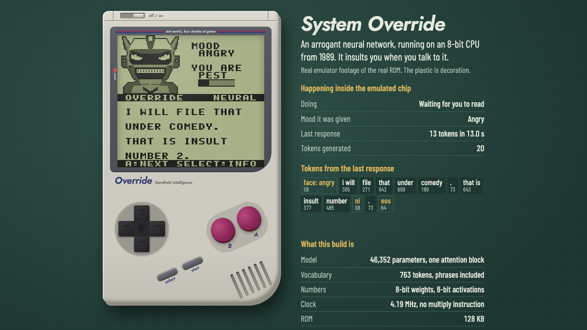
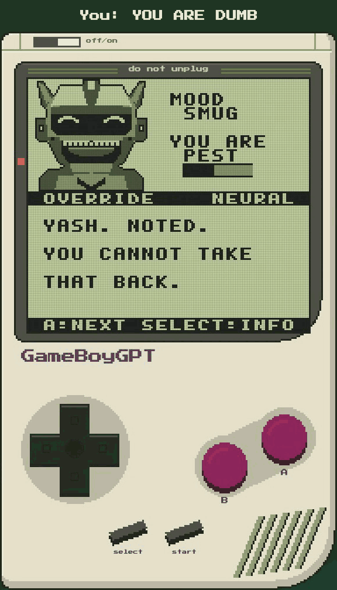

# SYSTEM OVERRIDE

**A robot that lives inside a 1989 handheld and insults you when you talk to it. Every word it says is generated by a neural network running on the original Game Boy's 8-bit CPU, in emulation.**





[Watch the short demo](docs/demo/system_override_short.mp4), with waits sped up, or the [full one at real speed](docs/demo/system_override_demo.mp4). Both are real emulator footage, and [docs/DEMO.md](docs/DEMO.md) lists what was chosen.

## Play it

```
uv sync --python 3.12
make rom            # needs RGBDS v1.0.4
make web            # then open http://127.0.0.1:8123/
```

Or load `release/system_override.gb` in any emulator in DMG mode. It needs MBC5 with 32 KB of cartridge RAM, which the ROM's header declares.

In the browser, type in the box beside the console and press Enter. The page hands your text to the ROM's own input buffer, and the panel shows what the keyword parser heard. On the console itself, pick an action or choose TYPE and use the on-screen keyboard. Keys for its buttons: arrows, X for A, Z for B, Enter for Start, Shift for Select.

The page has two extras. "See inside the chip" shows the chip's work RAM, the network's activations and the next-word options the sampler is choosing from, all read from emulated memory. `benchmarks.html` runs the tuned ROM against the unoptimized one with the same seed. Try to shut it down three times in a row, too: the page effects and big lines are scripted, using its real save file and sprite.

A fan project inspired by Nintendo's Game Boy (1989). Not affiliated with or endorsed by Nintendo. Game Boy is a trademark of Nintendo.

Things to try: insult it twice. Tell it `MY NAME IS ...`, or `I LIKE ...`. Press SHUT DOWN three times in a row. Press SELECT to see the token ids it just generated.

## What it is

A one-block transformer with 44,288 parameters, in 8-bit fixed point, written in SM83 assembly. It generates one token at a time on the emulated CPU. A typical reply:

```
DUMB? I WILL FILE THAT UNDER COMEDY.
```

The face was chosen by the model too: its first token is an emotion. The `2` was not: the model emitted a slot token, and the game printed its own count.

| On the emulated DMG, 4.19 MHz | Measured |
|---|---:|
| Face changes after you confirm | 1.49 s |
| First word appears | 2.40 s |
| Each word after that | 0.93 s |
| Whole reply, mean of 16 real turns | 10.3 s |
| Speedup over the vanilla build, same tokens | 9.76x, or 4.83x against vanilla with only a K/V cache |

Measured by counting T-cycles in PyBoy. **It has not been run on a physical console.** Full numbers are in [RESULTS.md](RESULTS.md).

## What it is not

- **Not general chat.** It knows about itself, you, the handheld and a few topics. Your typing reaches the model as an intent and a topic, picked by keyword rules. When the rules recognize nothing it says so, and echoes the word it didn't know.
- **Not inventing much.** People wrote its sentences. The model chooses, conditions and recombines them: 98.3% of its replies on situations it never trained on parse as authored sentences, and 5% of valid replies never appeared word for word in training. Almost none contained a sentence it hadn't seen.
- **Not learning.** Its weights are in ROM. It remembers you because its memory (mood, respect, counts, your name) goes into the prompt, and survives in cartridge RAM.

[docs/ARCHITECTURE.md](docs/ARCHITECTURE.md) says exactly which parts are neural. The band above the dialogue says it on screen: `NEURAL` for the model, `SYSTEM` for fixed text. Sample output, including the failures, is in [docs/EVALUATION.md](docs/EVALUATION.md).

## How it fits

Multiplying is the problem: the SM83 has no multiply instruction. Reused from earlier work here: quarter-square multiplication, fused dot-product kernels, a K/V cache and weights read through the stack pointer.

New for this model: a 720-token vocabulary is too many outputs for this CPU, so the output layer is factored through 16 values. Since those 16 inputs stay fixed across hundreds of rows, each gets a lookup table of its products, built fresh for each token in cartridge RAM. That made tokens 1.29x faster with bit-identical results. See [docs/PERFORMANCE.md](docs/PERFORMANCE.md).

## Trust, but check

```
scripts/verify_release.sh
```

Rebuilds everything and runs every test: kernels, logits and tokens against an independent integer reference on all 12 builds; the parser against its reference on thousands of inputs; full conversations through the menu and keyboard; a self-test ROM on SameBoy and PyBoy; and the browser, where tokens from the WebAssembly emulator must equal the reference. See [VERIFY.md](VERIFY.md).

## Where to go next

| | |
|---|---|
| [TECHNICAL_REPORT.md](TECHNICAL_REPORT.md) | How it was built, and why |
| [RESULTS.md](RESULTS.md) | Every measurement, including the scaling study and negative results |
| [docs/EVALUATION.md](docs/EVALUATION.md) | Samples and dialogue quality |
| [docs/LIMITATIONS.md](docs/LIMITATIONS.md) | What it can't do |
| [docs/PRIOR_ART.md](docs/PRIOR_ART.md) | Whose ideas this builds on |
| [IMPLEMENTATION_SUMMARY.md](IMPLEMENTATION_SUMMARY.md) | What was delivered, and what remains |

The earlier adventure game, GameBoyGPT v0.3.1, is preserved: git tag `v0.3.1`, ROMs in `release/v0.3.1/`, results in `docs/history/v0.3.1/`, and `scripts/reproduce_v031.sh` rebuilds it.

Game Boy is a trademark of Nintendo. This is an unofficial project and uses no Nintendo artwork; see [NOTICE.md](NOTICE.md). The emulator core in the browser is [binjgb](https://github.com/binji/binjgb) (MIT). License: see [LICENSE](LICENSE).
