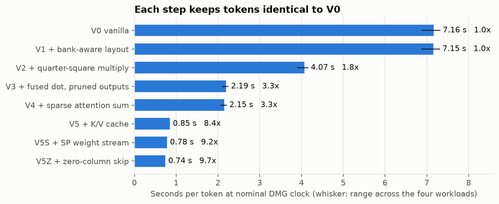
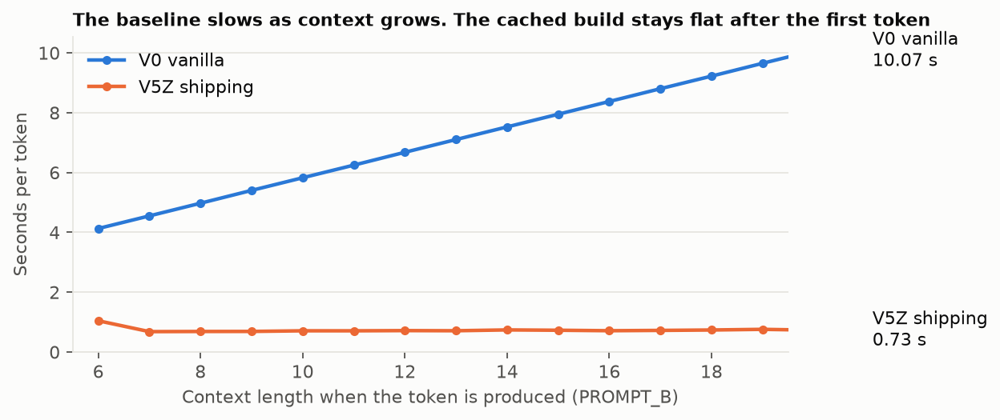
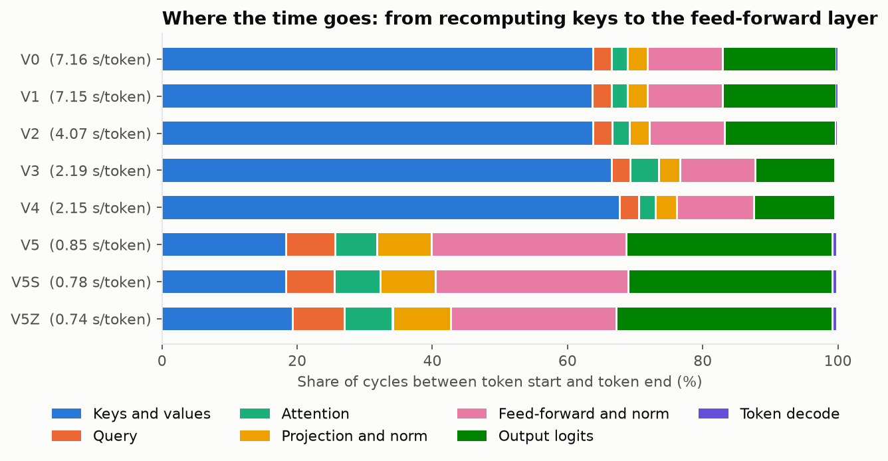
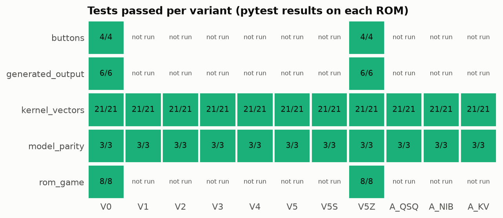
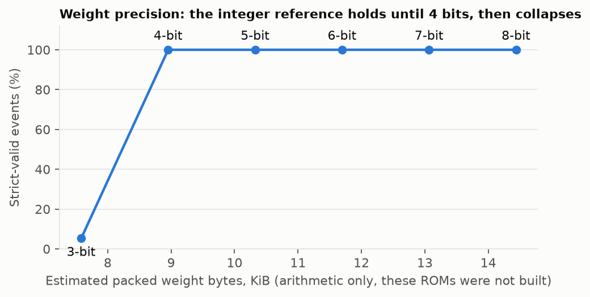

# Results

Generated by `tools/compare.py` from raw reports. Do not edit by hand. Timing is on an emulated original Game Boy (DMG), not physical hardware.

**Shipping build:** V5Z + zero-column skip. ROM SHA-256 `cbcb82e145b851c9d1c7d248790e6cd04802f3df5ac8542c9e653d7c99d4ea4c`, 65536 bytes, MBC5, no SRAM.
**Model:** 1-layer causal transformer, d=32, 2 heads, FFN 64, context 16, vocabulary 95, 14784 int8 parameters. Blob SHA-256 `2e2ca73681900e21385eeef725f07d31a29dad347b3878b9ed1ad9f40cb153d2`.
**Emulator:** PyBoy 2.9.0 with `cgb=False`, 4,194,304 Hz nominal. Commit at measurement: `13561b5`.

## Headline

| | V0 baseline | V5Z shipping |
|---|---:|---:|
| Seconds per token, mean over 4 workloads | 5.805 | 0.634 |
| Seconds per event | 56.6 | 6.18 |
| T-cycles per token | 24.35M | 2.66M |
| First token, T-cycles | 16.48M | 4.40M |
| Median later token, T-cycles | 25.18M | 2.44M |
| Allocated WRAM, bytes | 2631 | 2665 |
| Peak stack in the game loop (ISR and UI live), bytes | 44 | 38 |
| Bank switches per token | 779.8 | 0.0 |

**Speedup: 9.16x, with identical tokens on all four workloads.** Same model, same weights, same prompts, same greedy decoding.

**How much of that is the baseline's choice?** V0 recomputes every key and value for every token, which a port aimed at speed wouldn't do. Against V0 with only the K/V cache added, V5Z is 3.97x faster. That's the fairer figure for the kernel work alone.

## Cumulative optimization ablation

3 rounds on each of 4 workloads (39 tokens per round), in kernel mode (LCD off, IME off). "Step" is the gain over the row above. The emulator is deterministic, so rounds confirm stability and don't provide a sampling distribution. The range column reflects differences between workloads only.

| Variant | T/token | s/token | Workload range | s/event | vs V0 | Step | Banks/token | WRAM | Tokens = V0 |
|---|---:|---:|---:|---:|---:|---:|---:|---:|---:|
| V0 vanilla | 24.35M | 5.805 | 5.630-6.056 | 56.60 | 1.00x |  | 779.8 | 2631 | yes |
| V1 + bank-aware layout | 24.32M | 5.797 | 5.623-6.048 | 56.52 | 1.00x | 1.00x | 0.0 | 2631 | yes |
| V2 + quarter-square multiply | 13.83M | 3.298 | 3.198-3.441 | 32.15 | 1.76x | 1.76x | 0.0 | 2631 | yes |
| V3 + fused dot, pruned outputs | 7.62M | 1.818 | 1.761-1.900 | 17.72 | 3.19x | 1.81x | 0.0 | 2631 | yes |
| V4 + sparse attention sum | 7.49M | 1.785 | 1.728-1.865 | 17.40 | 3.25x | 1.02x | 0.0 | 2663 | yes |
| V5 + K/V cache | 3.08M | 0.734 | 0.732-0.736 | 7.16 | 7.90x | 2.43x | 0.0 | 2663 | yes |
| V5S + SP weight stream | 2.83M | 0.676 | 0.673-0.677 | 6.59 | 8.59x | 1.09x | 0.0 | 2665 | yes |
| V5Z + zero-column skip | 2.66M | 0.634 | 0.631-0.638 | 6.18 | 9.16x | 1.07x | 0.0 | 2665 | yes |

Largest within-workload round-to-round spread in the total: 96 T-cycles.

### Isolated toggles

Each is V0 with one change. Interactions are visible by comparing against the cumulative table.

| Variant | s/token | vs V0 | Tokens = V0 |
|---|---:|---:|---:|
| V0 + quarter squares only | 3.305 | 1.76x | yes |
| V0 + nibble table only | 4.835 | 1.20x | yes |
| V0 + K/V cache only | 2.517 | 2.31x | yes |

### Kernel microbenchmarks (T-cycles)

`MulS8` is the callable multiply. V3 and later keep it only for norm and attention weights; their dot products inline a MAC. Per-MAC figures come from a real matvec on real weights with a dense test vector, so they include row overhead. They do not show the benefit of zero skipping, which needs real sparse activations: V5Z costs more than V5S per MAC here and is still faster end to end.

| Variant | Mul (1x1) | Mul (mean of 6) | Per MAC, Q (1024) | Per MAC, F2 (2048) |
|---|---:|---:|---:|---:|
| V0 | 524 | 541 | 820 | 798 |
| A_NIB | 392 | 400 | 682 | 661 |
| A_QSQ | 196 | 196 | 464 | 443 |
| V3 | 196 | 196 | 254 | 237 |
| V5S | 196 | 196 | 232 | 213 |
| V5Z | 196 | 196 | 232 | 227 |

### Context length, single forward step from a cold start

| Variant | L=4 | L=8 | L=16 |
|---|---:|---:|---:|
| V0 | 14.69M | 21.82M | 36.09M |
| V3 | 4.46M | 6.79M | 11.45M |
| V5Z | 3.87M | 5.97M | 10.15M |

Without the cache, cost grows with context. V5Z's cold step at L=16 equals prefill: every later token then costs one position's K and V, as the headline's median shows.

### Where the time goes

Phases come from hooks on ROM labels, summed over all rounds.

### In the real game loop

LCD on, VBlank ISR running, words drawn as they arrive, seed 7, five scripted turns. "Frames" is what the ROM itself measured on-device. The last column compares the emulator's cycle count with frames x 70,224, an internal cross-check of the two clocks.

| Build | Events | Tokens | s/event | s/token | Frames/event | Cycles / (frames x 70224) |
|---|---:|---:|---:|---:|---:|---:|
| V0 | 5 | 48 | 55.98 | 5.831 | 3343 | 1.0001 |
| V5Z | 5 | 48 | 6.13 | 0.639 | 366 | 1.0005 |

## Correctness

- SM83 kernels vs the independent integer reference: mul, dot, requant, sat-add, ReLU, norm, attention weights, attention, matvec on real ROM weights, argmax and seeded sampling, with edge cases and fixed-seed randomized vectors.
- End to end: masked logits on 10 sequences including adversarial token streams, and token traces on 20 scenarios, each greedy and sampled.

| Variant | Tests passed | Tests run |
|---|---:|---:|
| V0 | 42 | 42 |
| V1 | 24 | 24 |
| V2 | 24 | 24 |
| V3 | 24 | 24 |
| V4 | 24 | 24 |
| V5 | 24 | 24 |
| V5S | 24 | 24 |
| V5Z | 42 | 42 |
| A_QSQ | 24 | 24 |
| A_NIB | 24 | 24 |
| A_KV | 24 | 24 |

### Second emulator

The self-test ROM generates the 4 workloads on the emulated CPU, compares tokens to expectations baked in at build time from the reference, and prints the verdict and LCD frames per workload.

| Build | Emulator | On-screen verdict | Frames per workload |
|---|---:|---:|---:|
| V0 | sameboy | SELFTEST PASS | 3060, 4023, 3527, 3060 |
| V0 | pyboy | SELFTEST PASS | 3060, 4023, 3527, 3060 |
| V5Z | sameboy | SELFTEST PASS | 343, 420, 386, 344 |
| V5Z | pyboy | SELFTEST PASS | 343, 420, 386, 344 |

### Timing calibration

`tests/test_smoke.py` runs a known instruction sequence and asserts PyBoy's counter between two hooks equals the hand-counted 112 T-cycles from Pan Docs timings. SameBoy has no equivalent counter in this setup: its check is the ROM's own LCD-frame counts above, which match PyBoy's exactly.

PyBoy's memory reads don't model PPU access locks, so VRAM comparisons in the tests can't detect a PPU-mode violation. The self-test screens read back from SameBoy cover that for the screens they draw, but not every game screen.

## Model quality

All figures are on the integer reference, which the ROM matches bit for bit. Training: 12000 float then 8000 QAT steps.

- Test NLL, quantized: 0.3101 nats/token. Same weights without fake-quant: 0.3100. Uniform over the vocabulary: 4.5539. Untrained model on validation: 5.2750.

| Condition | n | Strict valid | Action phrase | Room nouns | Outcome words | Token cap hit | Unique |
|---|---:|---:|---:|---:|---:|---:|---:|
| Trained, all situations, greedy | 283 | 1.000 | 1.000 | 1.000 | 1.000 | 0.000 | 159 |
| Trained, 9 held-out test families, greedy | 9 | 1.000 | 1.000 | 1.000 | 1.000 | 0.000 | 9 |
| Trained, all situations, sampled x3 | 849 | 1.000 | 1.000 | 1.000 | 1.000 | 0.000 | 536 |
| Trained, held-out test families, sampled x30 | 270 | 1.000 | 1.000 | 1.000 | 1.000 | 0.000 | 122 |
| **Untrained weights**, all situations, greedy | 283 | 0.000 | 0.205 | 0.049 | 0.088 | 1.000 | 219 |

Strict valid means the sentence is an exact member of the grammar for that situation. This is a narrow language, so 100% describes what the task asks of the model, not general language ability.

**Action conditioning.** Over the 225 situations whose sentences name the action (WIN and LOSE sentences don't, so the action column passes for them by default, which is why even untrained weights score above zero), changing only the action token changes the greedy event 100.0% of the time. The new event uses the new action's phrase 100.0% of the time and the old one's 0.0%.

**Sparsity.** On the integer reference across all 283 situations, 61.9% of feed-forward activations are exactly zero after ReLU, which is what V5Z exploits.

**Novelty audit** on the 9 held-out test families: 0.0% of generated prompt+text pairs exist in training, while 33.3% of the texts appear in training under some other prompt.

**Harder generalization test.** A separate model with the same recipe was trained on 60% of situations and scored on 85 unseen ones (not the shipping weights): strict validity 0.988 greedy, 0.988 sampled; on its training situations 1.000.

## Precision study (reference only)

Weights rounded to fewer bits with no retraining. Packed byte counts are arithmetic: **no INT4 ROM was built**, and whole-byte kernels would not get faster.

| Weight bits | Strict valid | Held-out strict | Token agreement with 8-bit | Cap rate | Estimated packed bytes |
|---|---:|---:|---:|---:|---:|
| 8 | 1.000 | 1.000 | 1.000 | 0.000 | 14784 |
| 7 | 1.000 | 1.000 | 0.466 | 0.000 | 13380 |
| 6 | 1.000 | 1.000 | 0.261 | 0.000 | 11976 |
| 5 | 1.000 | 1.000 | 0.258 | 0.000 | 10572 |
| 4 | 1.000 | 1.000 | 0.177 | 0.000 | 9168 |
| 3 | 0.053 | 0.000 | 0.000 | 0.018 | 7764 |

## A journey on the shipping ROM

Seed 321, sampled decoding. Every row's tokens match the reference. Frames are on-device; 59.73 frames is one second.

| Turn | Room | Action | Outcome | Generated text | Frames |
|---|---:|---:|---:|---:|---:|
| 1 | RUINS | RIGHT | MOVE | You turn right and the silent columns wait. | 346 |
| 2 | RUINS | SEARCH | LAMP | You look and find a lamp under the columns. | 384 |
| 3 | CAVE | FORWARD | MOVE | You press on and your lamp shows silent bats. | 382 |
| 4 | CAVE | SEARCH | KEY | You look and find a key under the dark bats. | 421 |
| 5 | SHRINE | FORWARD | MOVE | You walk on and your key hums by silent idols. | 420 |
| 6 | SHRINE | FORWARD | HURT | You walk on and the idols hurt you. | 348 |
| 7 | MARSH | FORWARD | MOVE | You press on and your key hums by silent reeds. | 419 |
| 8 | GATE | LEFT | MOVE | You turn left and your key hums by pale chains. | 420 |
| 9 | TOWER | FORWARD | OPEN | You press on and your key turns the gate opens. | 422 |
| 10 | TOWER | FORWARD | WIN | You climb the silent stairs and the guardian sleeps. | 388 |

Same state, two actions (seed 321, greedy):

- `[0, 1, 9, 14, 23]` FORWARD: You walk on and the pale roots bite.
- `[0, 1, 9, 15, 22]` SEARCH: You look but find only pale roots.

## Limitations

- Emulator only. No physical DMG has run this ROM. V5S and V5Z stream weights through SP with interrupts held off per row; V5 is the build to prefer if that is a concern on real hardware.
- Greedy parity is exact. Variety comes from seeded near-top sampling, which is deterministic and also bit-exact, but the sentences are always from a narrow trained language of 95 tokens.
- Game truth lives in the deterministic engine, which also supplies the outcome token. The model narrates; it cannot change state.
- The model is small: it has learned a grammar, and this is not conversational AI.
- INT4 was studied on the reference only. V7 (ternary or codebook weights) and V8 (automatic configuration search) were not attempted.
